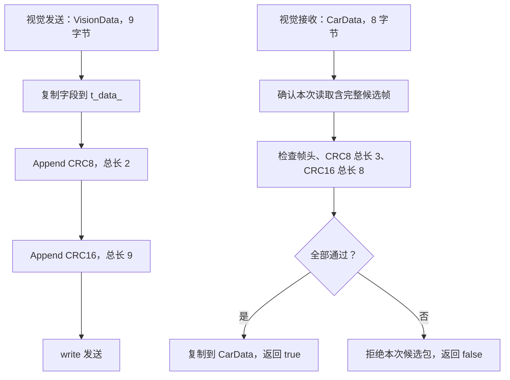

# CRC 校验问题与修改记录

整理日期：2026-11-10。代码修改日期：2026-11-05。

本文记录 Dart 视觉项目中发现的 CRC 问题、已经完成的修改，以及仍待处理的接收分帧问题，供联调和学习时对照。

阅读建议：需要先复习 CRC 原理和代码执行过程时，可先阅读第 10 节，再看前面的新旧代码对照。

**修改原则：只改视觉代码，适配电控提供的 `crc.c`，电控代码保持原样。**

文中的“旧代码”来自仓库原始版本 `37c87c0e804327a3a937acd06228f19983a20d23`，“新代码”来自整理时的工作区。代码块展示受影响的实际片段，未重复列出不变的 256 项查表和其他无关代码。为便于阅读，片段统一缩进，并省略部分空行和不参与执行的调试注释。

涉及的文件：

| 文件 | 用途 |
| --- | --- |
| [CRC_Check.cpp](../src/sensors/src/serialport/CRC_Check.cpp) | CRC8、CRC16 的计算、追加和验证函数。 |
| [SerialPort.cpp](../src/sensors/src/serialport/SerialPort.cpp) | 串口接收、发送和实际校验调用。 |
| [Struct.hpp](../src/utility/inc/global/Struct.hpp) | 收发数据包的字段布局；本次没有修改。 |
| [serial_crc_regression.cpp](../tests/serial_crc_regression.cpp) | CRC 与虚拟串口回归测试。 |
| [test_serial_crc.sh](../scripts/test_serial_crc.sh) | 编译并运行回归测试的脚本。 |

电控参考文件为 `/home/yc-mini/Downloads/crc.c` 和 `crc.h`。这两个文件只作为核对依据，没有修改。

## 1. 发现的问题和处理状态

| 问题 | 原来的情况 | 已做的改进 | 状态 |
| --- | --- | --- | --- |
| ① CRC16 算法不一致 | 视觉按低字节索引、右移；电控按高字节索引、左移，同一数据计算结果不同。 | 视觉 CRC16 更新步骤对齐电控现有实现。 | 已完成 |
| ② 发送 CRC8 缺失 | 发送调用被注释；旧函数还拒绝总长为 2 的输入，单独取消注释仍无效。 | 恢复发送 CRC8，并修复生成、验证函数的长度限制。 | 已完成 |
| ③ 接收没有验证整帧 CRC16 | 实际只检查帧头和 CRC8，部分载荷损坏也会被接受。 | 完整包必须同时通过 CRC8、CRC16 才更新接收结果。 | 已完成 |
| 接收边界缺失 | 短包可能产生负下标；读取长度没有限制在数组容量内。 | 增加读取上限、读取结果检查和完整帧长度检查。 | 已完成最小防护 |
| CRC16 字节顺序注释不准确 | 注释写“大端”，实际代码是低字节在前。 | 修正注释，字节顺序不变。 | 已完成 |
| 跨次读取拼包、错位恢复 | 不保留跨次读取的半包，没有逐字节重新同步机制。 | 本轮没有重写接收分帧流程。 | 待后续处理 |

## 2. 先理解包长度和校验范围

`Append` 表示把算出的 CRC 写入包中；`Verify` 表示重新计算并比较。

这些函数的长度参数**包含对应的校验字节**：CRC8 函数内部减去 1，CRC16 函数内部减去 2。

| 方向 | 整帧长度 | CRC8 所在偏移 | CRC8 调用长度／实际计算范围 | CRC16 调用长度／实际计算范围 |
| --- | --- | --- | --- | --- |
| 电控 → 视觉：`CarData` | 8 字节 | 2 | `3`／前 2 字节 | `8`／前 6 字节 |
| 视觉 → 电控：`VisionData` | 9 字节 | 1 | `2`／前 1 字节 | `9`／前 7 字节 |

CRC8 初值保持 `0xFF`；CRC16 初值保持 `0xFFFF`。CRC16 尾部保持**低字节先放、高字节后放**。

两个方向的结构不同，不能把 CRC8 调用长度都改成同一个值。`Struct.hpp` 中的字段顺序、`packed` 布局、`yaw_error` 的浮点格式均保持原样。

## 3. 问题①：视觉与电控的 CRC16 算法不一致

位置：`CRC_Check.cpp` 的 `Get_CRC16_Check_Sum()`。

两端的 CRC16 查表、初值和尾部字节顺序相同，但更新计算的方向不同。

**旧代码：**

```cpp
while (dwLength--)
{
    chData = *pchMessage++;
    (wCRC) = ((uint16_t)(wCRC) >> 8) ^ wCRC_Table[((uint16_t)(wCRC) ^ (uint16_t)(chData)) & 0x00ff];
}
```

这段使用 CRC 的低 8 位参与查表下标计算，然后右移 8 位。

**新代码：**

```cpp
while (dwLength--)
{
    chData = *pchMessage++;
    // Match the supplied firmware implementation, including its update direction.
    const uint8_t index = ((wCRC >> 8) ^ chData) & 0xff;
    wCRC = static_cast<uint16_t>((wCRC << 8) ^ wCRC_Table[index]);
}
```

新代码使用高 8 位计算下标，并左移更新，与电控所提供的 `crc16_core()` 一致。`static_cast<uint16_t>` 使每轮结果保留为 16 位，与电控 `uint16_t` 变量赋值的行为一致。

**这是对电控现有具体实现的适配，不代表换成了某个“标准 CRC16”。电控文件没有改。**

对同一组参与计算的字节进行比较：

```text
A5 00 00 00 00 00 00
```

| 实现 | CRC16 数值 | 按低字节在前写入包尾 |
| --- | --- | --- |
| 原视觉算法 | `0x66B2` | `B2 66` |
| 电控提供的算法／修改后的视觉算法 | `0x9324` | `24 93` |

因此，原来打印的 `A5 00 00 00 00 00 00 B2 66` 符合旧视觉的 CRC16，但不符合这份电控代码。差异在计算步骤，交换两个尾字节不能解决。

注意：上表保留了旧包中为 `00` 的 CRC8 字段，只用于隔离比较 CRC16。启用正确的 CRC8 后，CRC16 的输入也会变化；完整的新包见第 7 节。

## 4. 问题②：发送 CRC8 缺失，且旧函数不支持总长 2

这个问题需要同时修改函数的长度检查和发送调用。

### 4.1 CRC8 生成函数的长度检查

位置：`CRC_Check.cpp` 的 `Append_CRC8_Check_Sum()`。

**旧代码：**

```cpp
if ((pchMessage == 0) || (dwLength <= 2)) return;

ucCRC = Get_CRC8_Check_Sum((unsigned char *)pchMessage, dwLength - 1, CRC8_INIT);
pchMessage[dwLength - 1] = ucCRC;
```

**新代码：**

```cpp
if ((pchMessage == 0) || (dwLength <= 1)) return;

ucCRC = Get_CRC8_Check_Sum((unsigned char *)pchMessage, dwLength - 1, CRC8_INIT);
pchMessage[dwLength - 1] = ucCRC;
```

视觉发送包的前两个字节是 `header + CRC8`，调用长度为 `2`。旧判断会直接返回，新判断允许计算前 1 字节并将结果写到偏移 1。

### 4.2 CRC8 验证函数的长度检查

位置：`CRC_Check.cpp` 的 `Verify_CRC8_Check_Sum()`。

**旧代码：**

```cpp
if ((pchMessage == 0) || (dwLength <= 2)) return 0;

ucExpected = Get_CRC8_Check_Sum(pchMessage, dwLength - 1, CRC8_INIT);
return (ucExpected == pchMessage[dwLength - 1]);
```

**新代码：**

```cpp
if ((pchMessage == 0) || (dwLength <= 1)) return 0;

ucExpected = Get_CRC8_Check_Sum(pchMessage, dwLength - 1, CRC8_INIT);
return (ucExpected == pchMessage[dwLength - 1]);
```

这样验证函数也支持总长为 `2` 的输入。电控发来的 `CarData` 使用总长 `3`，其 CRC8 计算方式不受影响。

### 4.3 恢复发送 CRC8，并保证计算顺序

位置：`SerialPort.cpp` 的 `send()`。

**旧代码：**

```cpp
//Append_CRC8_Check_Sum(this->t_data_, 2);
Append_CRC16_Check_Sum(this->t_data_, sizeof(VisionData));
```

**新代码：**

```cpp
// CRC16 must cover the final CRC8 byte as well as the payload.
Append_CRC8_Check_Sum(this->t_data_, 2);
Append_CRC16_Check_Sum(this->t_data_, sizeof(VisionData));
```

发送顺序现在是：复制数据结构 → 填 CRC8 → 填 CRC16 → 调用 `write()`。

按现有算法，对单字节 `A5` 计算 CRC8 的结果也是 `A5`，所以发送包第二字节由原来的默认 `00` 变为 `A5`。

CRC16 会覆盖这个最终的 CRC8 字节，必须最后计算。不能先算 CRC16，再修改 CRC8。

也不能为了绕过旧函数的长度检查，把发送 CRC8 的参数随意改成 `3`：函数会写入 `dwLength - 1` 的位置，此时将覆盖偏移 2，也就是 `yaw_error` 的第一个字节。

## 5. 问题③：接收端缺少整帧 CRC16 检查

位置：`SerialPort.cpp` 的 `receive()` 最终接受条件。

旧接收函数已经验证了帧头和 CRC8，但没有实际验证整帧 CRC16。查找首个帧头的循环中虽有 CRC16 调用文字，但处于注释内，不会执行。

**旧代码：**

```cpp
if (this->r_data_[index] == 0xA5 &&
    Verify_CRC8_Check_Sum(&this->r_data_[index], 3)) {
    memcpy(&cd, &this->r_data_[index], sizeof(CarData));
    return true;
}
```

**新代码：**

```cpp
if (this->r_data_[index] == 0xA5 &&
    Verify_CRC8_Check_Sum(&this->r_data_[index], 3) &&
    Verify_CRC16_Check_Sum(&this->r_data_[index], sizeof(CarData))) {
    memcpy(&cd, &this->r_data_[index], sizeof(CarData));
    return true;
}
```

`CarData` 的 CRC8 只覆盖 `header` 和 `mode`，没有覆盖后面的 `status`、`number`、`dune`。这些字段由整帧 CRC16 保护。

例如使用当前算法的正确包：

```text
正确：A5 01 CE 00 01 00 A9 19
损坏：A5 01 CE 00 00 00 A9 19
                 ↑ number 被改动，尾部 CRC16 未重新计算
```

损坏包的 CRC8 仍能通过，但 CRC16 不通过。旧接收条件可能接受这样的包；新条件会拒绝，并保留调用者原来的 `CarData` 内容。

因此，新代码中的 `have data` 表示接收函数已经通过帧头、CRC8、CRC16 条件。它仍不代表目标已识别，也不代表电控已收到视觉回传包。

## 6. 为接收校验增加的边界防护

这部分用于保证校验时访问的是完整、已读取的数据，不等于已经实现跨次读取拼包。

### 6.1 限制读取长度，检查读取结果

位置：`SerialPort.cpp` 的 `receive()`，新增了 `<algorithm>` 头文件以使用 `std::min()`。

**旧代码：**

```cpp
bytes = read(this->fd_, this->r_data_, bytes);
```

**新代码：**

```cpp
// A serial read can return less than a frame; only inspect bytes actually read.
bytes = read(this->fd_, this->r_data_,
             std::min(static_cast<size_t>(bytes), sizeof(this->r_data_)));
if (bytes <= 0) {
    return false;
}
```

原接收数组容量是 `4096` 字节。现在单次读取最多等于数组容量，并在没有成功读到字节时结束本次接收。

### 6.2 收齐 8 字节后才计算候选帧位置

**旧代码：**

```cpp
int max_mul = (bytes - first_index) / sizeof(CarData);

if (first_index != -1) {
    int index = first_index + (max_mul - 1) *sizeof(CarData);
```

**新代码：**

```cpp
if (first_index != -1) {
    const int frame_size = static_cast<int>(sizeof(CarData));
    if (bytes - first_index < frame_size) {
        return false;
    }
    const int max_mul = (bytes - first_index) / frame_size;
    const int index = first_index + (max_mul - 1) * frame_size;
```

这些片段展示各自所在控制块的开头，后面才执行第 5 节的校验条件。

旧代码在只收到单字节 `A5` 时，`first_index = 0`、`max_mul = 0`，本机曾复现出 `index = -8`，随后访问 `r_data_[-8]` 越界。新代码在计算位置前检查剩余长度，不足 8 字节直接返回 `false`。

### 6.3 修正 CRC16 字节顺序注释

位置：`CRC_Check.cpp` 的 `Verify_CRC16_Check_Sum()`。

**旧代码：**

```cpp
//大端格式
return ((wExpected & 0xff) == pchMessage[dwLength - 2] && ((wExpected >> 8) & 0xff) == pchMessage[dwLength - 1]);
```

**新代码：**

```cpp
// CRC bytes are stored low byte first, as in the firmware.
return ((wExpected & 0xff) == pchMessage[dwLength - 2] && ((wExpected >> 8) & 0xff) == pchMessage[dwLength - 1]);
```

实际比较逻辑没有改变。原来那句“大端格式”注释不准确，现已明确低字节在前；同时移除了后面的未使用注释代码。

## 7. 修改后的完整示例包

### 7.1 电控 → 视觉：8 字节

```text
A5 01 CE 00 01 00 A9 19
```

| 字节偏移 | 值 | 含义 |
| --- | --- | --- |
| 0 | `A5` | 帧头 |
| 1 | `01` | mode = 1 |
| 2 | `CE` | 对 `A5 01` 计算的 CRC8 |
| 3 | `00` | status = 0 |
| 4 | `01` | number = 1 |
| 5 | `00` | dune = 0 |
| 6～7 | `A9 19` | CRC16 数值 `0x19A9`，低字节在前 |

### 7.2 视觉 → 电控：9 字节

零误差、未建立有效跟踪目标时：

```text
A5 A5 00 00 00 00 00 A3 65
```

| 字节偏移 | 值 | 含义 |
| --- | --- | --- |
| 0 | `A5` | 帧头 |
| 1 | `A5` | 对帧头 `A5` 计算的 CRC8 |
| 2～5 | `00 00 00 00` | float 类型的 yaw_error = 0 |
| 6 | `00` | target_status = 0 |
| 7～8 | `A3 65` | CRC16 数值 `0x65A3`，低字节在前 |

同样零误差、`target_status = 1` 时，新包为：

```text
A5 A5 00 00 00 00 01 2A 74
```

## 8. 已有验证结果及复现方法

以下是 **2026-11-05 修改完成时的验证记录**。本次 2026-11-10 的工作是整理文档，不把历史测试写成当天新做的实机测试。

### 8.1 与电控函数的随机差分验证

当时将实际视觉 CRC 源码与电控文件的软件 CRC 部分分别编译，对比了 10,000 组随机输入及初值，计算、追加、验证结果一致。

这项验证使用临时程序，和下面持久保存的 6 组回归测试是两项不同的检查；临时文件可能被系统清理。

### 8.2 项目内保存的 6 组回归测试

`tests/serial_crc_regression.cpp` 和 `scripts/test_serial_crc.sh` 已加入项目，覆盖：

1. 电控固定 CRC 向量，以及总长为 2、3 的 CRC8。
2. 无效短长度和空指针。
3. 实际 `SerialPort::send()` 发送的未锁定／已锁定状态包。
4. 实际 `receive()` 接受合法包，拒绝载荷损坏、CRC8 损坏、CRC16 损坏及旧算法 CRC16 包。
5. 1～7 字节短包安全返回，不越界。
6. 两个完整包选择后一个完整包，以及完整包后附半包时仍可返回前面的完整包。

当时 6 组测试全部通过。测试使用自建 PTY 虚拟串口，原串口打开调用通过 `--wrap=open` 重定向，没有打开真实电控串口；启用了 UBSan/bounds 检查，未报告越界。它没有使用 ASan，也没有验证实际电控固件的运行情况。

在项目根目录可重新运行：

```bash
cd /home/yc-mini/Dart
bash scripts/test_serial_crc.sh
```

### 8.3 编译和文件范围检查

修改当时执行 `cmake --build build --parallel 2`，全项目 15 步编译通过。原相机和录像模块仍有此前的编译警告。`git diff --check` 通过。

电控 `crc.c`、`crc.h` 修改前后 SHA256 一致，2026-11-10 整理时只读复核也一致：

```text
crc.c  a959f4b03131e47ba74bca11860604c2fef3f62d2be64f10d70c8b295a4614ec
crc.h  0d90b0bdf64b47048291d013b647ac37ccd557e3f022e2d3118c8038552d6e01
```

## 9. 仍待后续处理的接收问题

按当时“先修第 1、2、3 项”的范围，本轮增加了必要的读取和短包边界检查，但没有实现完整的串口流解析器。

当前流程仍是：找本次读取中的第一个 `A5` → 从该位置按 8 字节对齐 → 选择最后一个完整候选包 → 验证 CRC8、CRC16。

因此仍有以下限制：

- 一个包拆成两次 `read()` 到达时，不会缓存并拼回。
- 完整包后面的残包字节没有保留到下一次读取。
- 第一个 `A5` 如果属于噪声或上一帧残片，不会逐字节重新寻找后面的合法包。
- 最后候选包校验失败时，不会回退尝试同次读取中更早的合法包。
- `write()` 仍没有完整处理短写，这次没有重写发送机制。

目前的离线验证证明视觉 CRC 计算和提供的电控函数一致、测试条件下的收发校验符合预期；真实电控端的接收回调、调用长度、发包频率及长期运行仍需实机联调确认。

## 10. CRC 的原理，以及本项目如何实现

### 10.1 CRC 在通信中负责什么

CRC 是循环冗余校验。发送方按照双方约定的规则，从数据中计算出一个校验值，放进数据包；接收方用相同规则重新计算，再与收到的校验值比较。

```text
发送方：数据 → 计算 CRC → 数据和 CRC 一起发送
接收方：收到数据和 CRC → 对数据重算 CRC → 比较是否一致
```

CRC8 表示校验值是 8 位，也就是 1 字节；CRC16 表示校验值是 16 位，也就是 2 字节。这里的 8、16 表示校验值的宽度，不是数据包长度。

CRC 用于发现数据错误，不负责修正数据，也不负责把串口半包拼接完整。校验通过表示通过了约定的检查，仍存在某些不同数据得到相同校验值的可能。

### 10.2 数学原理：用异或做模 2 除法

把一串二进制数据看成多项式。例如 `1011` 可以表示 `x³ + x + 1`。CRC 的基本原理是用双方约定的生成多项式做模 2 除法，把余数作为校验值。

模 2 运算中不进行普通减法的借位，而使用逐位异或 `XOR`：

| 左边的位 | 右边的位 | 异或结果 |
| --- | --- | --- |
| 0 | 0 | 0 |
| 0 | 1 | 1 |
| 1 | 0 | 1 |
| 1 | 1 | 0 |

例如 `1101 XOR 1011 = 0110`。C/C++ 中的 `^` 就是异或，不是乘方。

下面用一个 **3 位校验的小例子**说明原理。这个例子采用零初值，不做输入输出反射或最终异或，仅用于说明除法过程，不是本项目的 CRC8、CRC16 参数。

- 数据：`1101`。
- 生成多项式：`1011`，最高次数为 3，所以余数占 3 位。
- 在数据末尾补 3 个零，得到 `1101000`。
- 每次将除数的最高位与当前余数的最高位对齐，然后异或。

```text
1101000 XOR 1011000 = 0110000
0110000 XOR 0101100 = 0011100
0011100 XOR 0010110 = 0001010
0001010 XOR 0001011 = 0000001
```

最后保留 3 位，余数是 `001`。把它放到原数据后面，就得到这个玩具例子的发送比特串 `1101 001`。

实际 CRC 实现还需要约定初值、输入输出处理、更新方向等参数。项目调用时直接传入实际数据字节，没有手工在包尾另加上述玩具例子的零位。**本项目当前 CRC16 以电控提供的具体查表和更新代码为准，不能把上面的玩具除法过程直接当作当前算法，或仅凭“CRC16”这个名字推断某种标准变体。**

### 10.3 为什么代码使用查表

标准的查表 CRC 实现，可以将一字节对应的多次逐位运算预先算好，保存在 256 项表里。因为一个字节有 `0～255` 共 256 种取值，所以可以用 8 位索引查表。

查表、索引方式、移位方向必须配套；只知道表相同，不能保证结果相同。第 3 节中的旧视觉代码和电控代码，正是更新步骤不同导致结果不同。

对本项目，按源码执行以下约定：

| 项目 | CRC8 | 当前 CRC16 |
| --- | --- | --- |
| 初值 | `0xFF` | `0xFFFF` |
| 查表 | `CRC8_TAB[256]` | `wCRC_Table[256]` |
| 索引 | 当前 CRC 与输入字节异或 | CRC 高 8 位与输入字节异或，保留低 8 位 |
| 更新 | 用表中值替换当前 CRC | CRC 左移 8 位，与表值异或，保留 16 位 |
| 写入包中 | 1 字节 | 低字节先放，高字节后放 |

CRC16 这一列描述的是当前为兼容电控而采用的实现，不将它归类为某个标准模型，也不把它的查表和移位方向随意替换。

初值是计算开始时的内部状态，不是直接填进包里的校验字节。例如 CRC8 初值是 `FF`，不表示发送包的 CRC8 字段也必须是 `FF`。

### 10.4 三类函数各自做什么

| 函数类别 | 本项目函数 | 传入的长度表示什么 | 做的事情 |
| --- | --- | --- | --- |
| 核心计算 | `Get_CRC8_Check_Sum()` | 实际参与计算的数据字节数 | 从指定初值开始计算，返回 CRC8。 |
| 核心计算 | `Get_CRC16_Check_Sum()` | 实际参与计算的数据字节数 | 从指定初值开始计算，返回 CRC16。 |
| 填入校验值 | `Append_CRC8_Check_Sum()` | 数据及末尾 1 字节 CRC8 的总长 | 对前 `总长－1` 字节计算，将结果写到末尾。 |
| 填入校验值 | `Append_CRC16_Check_Sum()` | 数据及末尾 2 字节 CRC16 的总长 | 对前 `总长－2` 字节计算，将结果写到末尾。 |
| 验证校验值 | `Verify_CRC8_Check_Sum()` | 数据及末尾 1 字节 CRC8 的总长 | 重算前面的数据，与收到的 CRC8 比较。 |
| 验证校验值 | `Verify_CRC16_Check_Sum()` | 数据及末尾 2 字节 CRC16 的总长 | 重算前面的数据，与收到的 CRC16 比较。 |

例如对 9 字节的 `VisionData` 计算 CRC16：直接调用核心计算函数时，数据长度是 `7`；调用 `Append` 或 `Verify` 时，总长是 `9`，它们内部会减去 `2`。

因此，第 2 节中“长度包含校验字节”的约定针对的是 `Append/Verify`。核心计算函数不会再替调用者减去校验字节。

### 10.5 CRC8：逐字节执行的代码与例子

当前核心函数位于 `CRC_Check.cpp`：

```cpp
unsigned char Get_CRC8_Check_Sum(unsigned char *pchMessage, unsigned int dwLength, unsigned char ucCRC8)
{
    unsigned char ucIndex;

    while (dwLength--) {
        ucIndex = ucCRC8 ^ (*pchMessage++);
        ucCRC8 = CRC8_TAB[ucIndex];
    }

    return (ucCRC8);
}
```

参数与执行过程：

1. `pchMessage` 指向第一个参与计算的数据字节。
2. `dwLength` 是需要处理的字节数；循环每次处理 1 字节。
3. `ucCRC8` 是当前状态，`Append/Verify` 调用时传入初值 `CRC8_INIT = 0xFF`。
4. 将当前状态与输入字节异或，得到表索引。
5. 读取 `CRC8_TAB` 中该索引的值，作为新的状态。
6. 数据处理完后，返回最终状态。

**例子一：视觉发送头中的单字节 `A5`。**

```text
初始状态：crc = FF
输入字节：byte = A5
计算索引：index = FF XOR A5 = 5A
读取表值：CRC8_TAB[5A] = A5
最终 CRC8：A5
```

所以视觉发送包的开头是 `A5 A5`：第一个是帧头，第二个是算出来的 CRC8。

**例子二：电控发送头中的两个字节 `A5 01`。**

第一轮处理 `A5` 后，状态已经变成 `A5`，再处理 `01`：

```text
上一状态：crc = A5
输入字节：byte = 01
计算索引：index = A5 XOR 01 = A4
读取表值：CRC8_TAB[A4] = CE
最终 CRC8：CE
```

因此 `mode = 1` 的电控包开头为 `A5 01 CE`。这里调用 CRC8 的 `Append/Verify` 总长为 `3`，实际计算的是前两个字节。

### 10.6 CRC16：当前核心代码如何更新状态

当前核心函数为：

```cpp
uint16_t Get_CRC16_Check_Sum(uint8_t *pchMessage, uint32_t dwLength, uint16_t wCRC)
{
    uint8_t chData;

    if (pchMessage == nullptr)
    {
        return 0xFFFF;
    }

    while (dwLength--)
    {
        chData = *pchMessage++;
        // Match the supplied firmware implementation, including its update direction.
        const uint8_t index = ((wCRC >> 8) ^ chData) & 0xff;
        wCRC = static_cast<uint16_t>((wCRC << 8) ^ wCRC_Table[index]);
    }

    return wCRC;
}
```

每轮有三个关键动作：

1. `chData = *pchMessage++`：取出一个输入字节，并把指针移到下一个字节。
2. `((wCRC >> 8) ^ chData) & 0xff`：取当前 CRC 的高 8 位，与输入字节异或，生成 0～255 的索引。
3. `(wCRC << 8) ^ wCRC_Table[index]`：左移当前状态，与表值异或，再转为 `uint16_t`，保留低 16 位。

用零误差、未锁定目标的视觉包演示。已经填好 CRC8 后，参与 CRC16 计算的前 7 字节是：

```text
A5 A5 00 00 00 00 00
```

计算从 `FFFF` 开始。下表中的数值均为十六进制，已经按当前源码的查表和更新步骤逐轮核对：

| 轮次 | 更新前 CRC | 输入字节 | 表索引 | 查到的表值 | 更新后 CRC |
| --- | --- | --- | --- | --- | --- |
| 1 | `FFFF` | `A5` | `5A` | `FDDF` | `02DF` |
| 2 | `02DF` | `A5` | `A7` | `D1B5` | `0EB5` |
| 3 | `0EB5` | `00` | `0E` | `E97E` | `5C7E` |
| 4 | `5C7E` | `00` | `5C` | `98E9` | `E6E9` |
| 5 | `E6E9` | `00` | `E6` | `8238` | `6B38` |
| 6 | `6B38` | `00` | `6B` | `DDD5` | `E5D5` |
| 7 | `E5D5` | `00` | `E5` | `B0A3` | `65A3` |

第一轮可以展开为：

```text
index = ((FFFF >> 8) XOR A5) & FF
      = (FF XOR A5) & FF
      = 5A

new_crc = ((FFFF << 8) XOR FDDF) 的低16位
        = 02DF
```

7 个字节处理结束，CRC16 的数值是 `0x65A3`。

### 10.7 Append：如何把算出的 CRC16 放进包里

`Append_CRC16_Check_Sum()` 中实际负责计算和写入的是：

```cpp
wCRC = Get_CRC16_Check_Sum((uint8_t *)pchMessage, dwLength - 2, CRC_INIT);
pchMessage[dwLength - 2] = (uint8_t)(wCRC & 0x00ff);
pchMessage[dwLength - 1] = (uint8_t)((wCRC >> 8) & 0x00ff);
```

对 `VisionData`，`dwLength = 9`：

- 计算前 `9－2 = 7` 字节，得到 `65A3`。
- `65A3 & 00FF = A3`，写到偏移 `7`。
- `(65A3 >> 8) & 00FF = 65`，写到偏移 `8`。

因此完整发送包变成：

```text
A5 A5 00 00 00 00 00 A3 65
```

**CRC 数值写作 `0x65A3`，在线上的两个字节写成 `A3 65`，两者表示同一个值。** 算法计算时采用左移，与传输时低字节在前，是两个不同层次的约定，并不矛盾。

### 10.8 Verify：接收方怎样判断校验通过

本项目接收端使用“重新计算，再比较字段”的方法。

CRC8 的关键代码是：

```cpp
ucExpected = Get_CRC8_Check_Sum(pchMessage, dwLength - 1, CRC8_INIT);
return (ucExpected == pchMessage[dwLength - 1]);
```

CRC16 的关键代码是：

```cpp
wExpected = Get_CRC16_Check_Sum(pchMessage, dwLength - 2, CRC_INIT);
// CRC bytes are stored low byte first, as in the firmware.
return ((wExpected & 0xff) == pchMessage[dwLength - 2] && ((wExpected >> 8) & 0xff) == pchMessage[dwLength - 1]);
```

以电控发来的 `A5 01 CE 00 01 00 A9 19` 为例：

1. 检查帧头为 `A5`。
2. `Verify_CRC8_Check_Sum(..., 3)` 对前两个字节 `A5 01` 重算，得到 `CE`，与偏移 2 的字节比较。
3. `Verify_CRC16_Check_Sum(..., 8)` 对前六个字节 `A5 01 CE 00 01 00` 重算，得到 `19A9`。
4. 比较收到的尾部：低字节应为 `A9`，高字节应为 `19`。
5. 两项校验均通过，`receive()` 才复制该包到 `CarData` 并返回 `true`。

这里的判断条件是“重算结果与收到的字段一致”，不是把完整包送进当前函数后检查结果是否为零。

### 10.9 把函数放回实际收发流程



发送端先填 CRC8，再算 CRC16，是因为 CRC8 字段本身也在 CRC16 覆盖的前 7 字节内。先算 CRC16 后再改 CRC8，会使已经填入的 CRC16 失效。

双方对齐时，需要同时核对数据字段与覆盖范围、初值、查表、索引和移位方向，以及校验值在包中的存放顺序。只看到函数都叫 `CRC16`，或者串口能打印数据，不能说明这些约定已经一致。

### 10.10 阅读这些 C++ 代码时常见的符号

| 符号或写法 | 在这里的含义 |
| --- | --- |
| `0xFF`、`0xFFFF` | 十六进制数，分别为低 8 位和低 16 位全是 1。 |
| `^` | 逐位异或，相同为 0、不同为 1。 |
| `& 0xFF` | 只保留结果的低 8 位。 |
| `>> 8` | 右移 8 位；对 16 位 CRC 可用于取出高字节。 |
| `<< 8` | 左移 8 位，在当前 CRC16 实现中参与状态更新。 |
| `static_cast<uint16_t>(...)` | 将结果保留为 16 位无符号数。 |
| `*pchMessage++` | 读取指针当前位置的字节，再让指针前进一个字节。 |
| `while (dwLength--)` | 每轮处理一个字节，循环次数等于传入长度。 |
| `dwLength - 1`／`dwLength - 2` | 在 Append/Verify 中排除末尾 CRC8／CRC16 字段。 |
| `&&` | 所有条件都成立才通过；前一个条件失败时，不执行后续条件。 |

学习顺序可以是：先理解“发送计算、接收比较”，再手算 CRC8 的两个查表例子，最后沿着 CRC16 状态表阅读完整收发过程。
